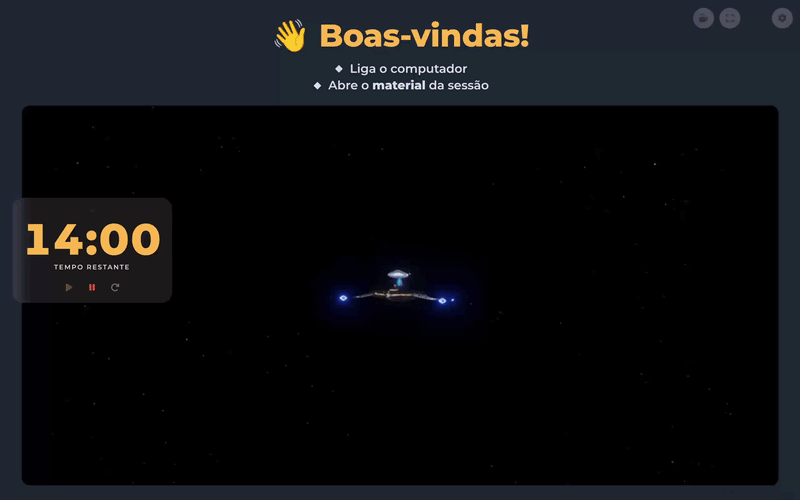

# Palco

Quadro digital para formadores. Duas janelas no mesmo navegador: a **TV** mostra cena, temporizador e vídeos/site; o **Controlo** edita tudo e comanda a TV em tempo real.

## Experimentar

**[Abrir Palco](https://criacoes.100nome.net/web/palco/)** — versão pública.

Ou localmente:

    git clone https://github.com/100nome-criacoes/palco.git
    cd palco
    python3 -m http.server 8000

Depois abre `http://localhost:8000/index.html` na TV e `http://localhost:8000/control.html` no portátil. **Precisa de servidor** (não `file://`): o `localStorage` e o evento `storage` exigem a mesma origem.

## O problema

Formadores em sessões práticas precisam de mostrar instruções, vídeos e um temporizador aos participantes, mas configurá-los ao vivo interrompe a sessão. O Palco separa a **apresentação** (TV) do **controlo** (portátil): o formador edita em silêncio, a TV continua a mostrar o que os participantes veem.

## Funcionalidades

- **Grupos e cenas configuráveis** — cada cena tem o seu texto, cor, duração e modo de apresentação
- **Temas de cor** com contraste automático, para nunca haver combinações ilegíveis, e um tema de **alto contraste**
- **Tamanho do texto** ajustável (4 níveis) para salas compridas, com o subtexto a crescer mais do que o título
- **Vídeos do YouTube e sites incorporados** (Google Slides, apresentações), com som por vídeo, troca 1 ↔ 2 e campos que mostram claramente o que está guardado
- **Galeria de imagens** — arrasta imagens ou uma pasta; passam na TV com transição suave e controlo remoto (anterior, pausa, seguinte). Ficam só no navegador, numa cópia reduzida
- **Pré-visualização da TV no controlo**, uma réplica a 1080p com as cores, as posições do temporizador e as miniaturas dos vídeos
- **Temporizador** que conta pelo relógio (não perde tempo em segundo plano) e publica o estado para o controlo. Cada cena pode mostrá-lo em coluna, em barra ou escondê-lo
- **Modo pausa** com o tempo em grande, legível à distância
- **Modo "só tempo"** — esconde vídeos e destaca o temporizador
- **Persistência local** com exportação e importação em JSON

## Como os dados fluem

- Todo o estado vive no `Store`. Qualquer alteração faz *ler estado mais recente → alterar → gravar*, por isso as duas janelas nunca se sobrepõem. A outra janela é avisada pelo evento `storage`.
- O controlo **não envia edições** à TV: grava no `Store` e a TV desenha. Só ações momentâneas (iniciar/pausar/repor) usam `Sync.send`.
- **Em direto ≠ a editar.** Editar uma cena no controlo não mexe na TV, exceto se for a cena que está em direto.

## Regras do temporizador

| Evento                                   | Temporizador                                    |
|------------------------------------------|-------------------------------------------------|
| Entrar numa cena de **pausa**            | repõe (duração da cena ou global) e **arranca** |
| Entrar numa cena **com duração própria** | repõe e fica **parado**, pronto a iniciar       |
| Sair da pausa para outra cena            | repõe, parado                                   |
| Qualquer outra mudança de cena           | não é tocado                                    |

## Notas de utilização

- Só funciona com as duas janelas no **mesmo navegador, perfil e origem**. Para controlar a TV a partir de *outro dispositivo* seria preciso um servidor (WebSocket).
- **Imagens:** ficam no IndexedDB deste navegador (cópia reduzida a 1920 px; os originais não são tocados) e **não vão no ficheiro exportado**. Remover uma imagem apaga-a do navegador, e "Repor valores de origem" apaga todas.
- **Som (alarme e vídeos com som):** o navegador só o permite depois de um clique ou tecla na janela da TV. Faz um clique nela antes de começar.
- **Ecrã inteiro:** `F` na janela da TV (o navegador não permite ativá-lo à distância).
- Os dados ficam em `localStorage` (`palco_session`). O formato tem um número de versão (`Store.VERSION`), guardado também no ficheiro exportado, para permitir converter dados antigos se o formato mudar.

## Personalizar e renomear

- **Marca e versão:** `js/app-info.js` (nome, subtítulo, autor, versão, codinome, `slug`). O `slug` prefixa as chaves do `localStorage`, o canal e as janelas. Se o mudares, exporta antes e importa depois.
- **Textos das cenas de origem:** `Scenes.PRESETS` em `js/scenes.js` (só afetam instalações novas e o "Restaurar texto original").
- **Cores:** variáveis em `css/base.css` (`:root`) e temas em `Scenes.THEMES`.
- **O teu setup:** usa **Exportar** no controlo para guardar cenas, grupos e textos num `.json`, e **Importar** para os repor.

## Estrutura

Ver [ARCHITECTURE.md](ARCHITECTURE.md) para a descrição de cada módulo e das decisões de design.

    index.html · control.html
    css/    base.css · board.css · control.css
    js/     app-info.js · utils.js · scenes.js · store.js · sync.js
            notify.js · actions.js · timer.js · draggable.js
            images.js · slideshow.js · media.js · board-view.js · app-board.js
            control-preview.js · control-gallery.js · app-control.js
    tests/  logic.test.js

## Contribuir

Bugs, sugestões e pull requests são bem-vindos. Ver [CONTRIBUTING.md](CONTRIBUTING.md).

## Licença

Distribuído sob a licença MIT. Ver [LICENSE](LICENSE).
